# circuit-diagram으로 배우는 웹 개발

이 문서는 circuit-diagram(CD) 프로젝트의 코드를 교재 삼아 웹 개발을 공부하기 위한 안내서입니다.
"이 기능은 어떻게 만들어졌을까?"를 따라가며 Next.js, React, 상태 관리, 테스트, Git까지 한 번씩 짚어 봅니다.

- 처음 나오는 어려운 용어는 **굵게** 표시하고, 맨 아래 [용어 사전](#15-용어-사전)에 정의를 모아 두었습니다.
- 코드 예시는 실제 파일에서 가져왔고, 설명에 필요 없는 부분은 `…`로 줄였습니다. 파일 이름을 누르면 원본으로 이동합니다.
- 각 장 끝의 **확인 문제**로 이해했는지 점검해 보세요.

## 목차

0. [시작하기 전에](#0-시작하기-전에)
1. [프로젝트 한눈에 보기](#1-프로젝트-한눈에-보기)
2. [웹 앱은 어떻게 동작할까](#2-웹-앱은-어떻게-동작할까)
3. [폴더 구조와 계층 나누기](#3-폴더-구조와-계층-나누기)
4. [Next.js](#4-nextjs)
5. [React 핵심](#5-react-핵심)
6. [상태 관리: zustand](#6-상태-관리-zustand)
7. [React Flow: 노드와 선](#7-react-flow-노드와-선)
8. [논리 회로와 시뮬레이션](#8-논리-회로와-시뮬레이션)
9. [격자에 맞춘 설계](#9-격자에-맞춘-설계)
10. [기능별 구현 해설](#10-기능별-구현-해설)
11. [스타일링](#11-스타일링)
12. [테스트](#12-테스트)
13. [Git 작업 흐름](#13-git-작업-흐름)
14. [연습 과제](#14-연습-과제)
15. [용어 사전](#15-용어-사전)

---

## 0. 시작하기 전에

### 준비물
- **Node.js** 20 이상 (`node -v`로 확인)
- 코드 편집기 (VS Code 추천)
- 터미널 기본 사용법 (`cd`, `ls`)

### 내 컴퓨터에서 실행하기

```bash
git clone https://github.com/Monster1365/circuit-diagram.git
cd circuit-diagram
git checkout develop      # 개발은 develop 브랜치에서 합니다
npm install               # 필요한 라이브러리 내려받기
npm run dev               # 개발 서버 실행 → http://localhost:3000
```

`npm run dev`는 **개발 서버**를 띄웁니다. 코드를 저장하면 브라우저 화면이 자동으로 바뀌는데, 이를 **핫 리로드**라고 합니다.
공부하면서 코드를 조금씩 고쳐 보고 화면이 어떻게 바뀌는지 직접 확인하는 것이 가장 빠른 학습 방법입니다.

---

## 1. 프로젝트 한눈에 보기

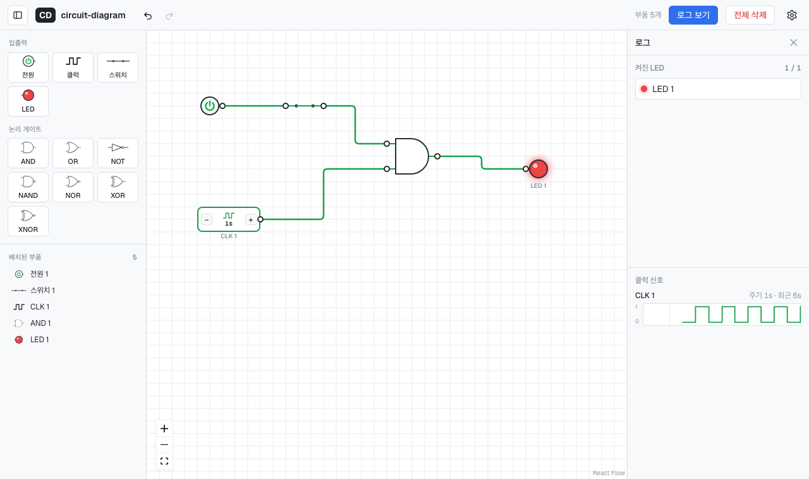

화면은 네 부분으로 나뉩니다.

| 위치 | 이름 | 하는 일 | 주요 파일 |
|---|---|---|---|
| 위 | 상단바 | 도구상자 열기/닫기, 되돌리기, 로그 보기, 전체 삭제, 설정 | [TopBar.tsx](../src/components/editor/TopBar.tsx) |
| 왼쪽 | 도구상자 | 부품 버튼, 배치된 부품 목록 | [Toolbox.tsx](../src/components/editor/Toolbox.tsx) |
| 가운데 | 캔버스 | 부품을 놓고 선으로 잇는 곳 | [Editor.tsx](../src/components/editor/Editor.tsx) |
| 오른쪽 | 로그 | 켜진 LED 목록, 클럭 그래프 | [LogPanel.tsx](../src/components/editor/LogPanel.tsx) |

위 그림에서는 **전원 → 스위치 → AND ← 클럭** 회로를 만들었습니다. 스위치가 닫혀 있고, 클럭이 1일 때만 AND의 두 입력이 모두 1이 되어 LED가 켜집니다.
오른쪽 로그의 그래프가 클럭 신호이고, LED는 이 박자에 맞춰 깜빡입니다.

### 클릭 한 번에 일어나는 일

스위치를 클릭했을 때 코드 안에서 일어나는 일을 미리 보면 이렇습니다. 지금은 흐름만 보고, 각 단계는 뒤에서 자세히 다룹니다.

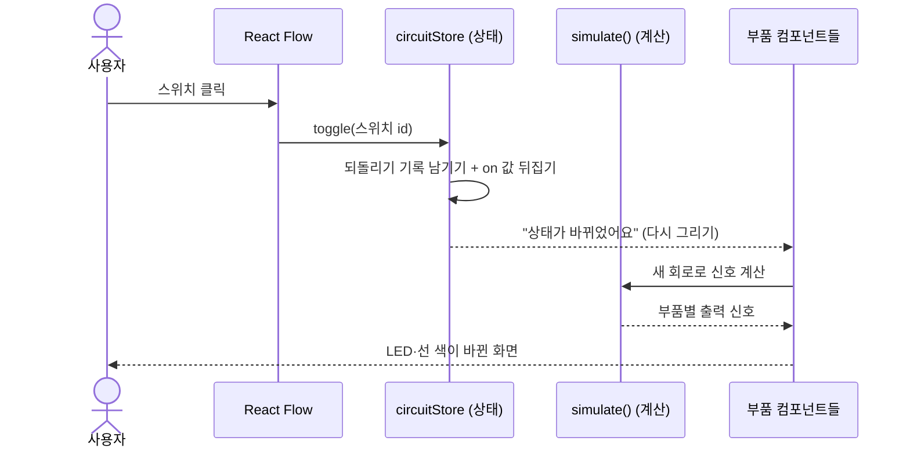

핵심은 **"상태(데이터)가 바뀌면 화면은 그 상태에서 다시 계산된다"** 는 것입니다. 화면을 직접 고치지 않고 데이터만 바꾸면, React가 알아서 화면을 다시 그립니다. 이것이 React를 쓰는 가장 큰 이유입니다.

> **확인 문제**: LED가 켜졌는지를 데이터로 저장해 두지 않는 이유는 무엇일까요? (힌트: 8장)

---

## 2. 웹 앱은 어떻게 동작할까

### 브라우저와 서버

- **브라우저**(Chrome, Safari)는 웹 페이지를 받아서 화면에 그리고, 페이지 안의 JavaScript를 실행합니다.
- **서버**는 요청을 받으면 HTML, CSS, JavaScript 파일을 돌려주는 컴퓨터입니다.

이 프로젝트는 회로 계산을 **전부 브라우저에서** 합니다. 서버는 처음에 파일을 한 번 보내 줄 뿐, 회로 데이터를 받지도 계산하지도 않습니다. 덕분에 서버 비용이 거의 들지 않고 반응이 빠릅니다.

### 웹의 세 가지 언어

| 언어 | 역할 | 이 프로젝트에서 |
|---|---|---|
| HTML | 화면의 구조 (제목, 버튼, 목록) | React 컴포넌트가 JSX로 만들어 냄 |
| CSS | 모양 (색, 크기, 배치) | Tailwind CSS 클래스 + [globals.css](../src/app/globals.css) |
| JavaScript | 동작 (클릭하면 무엇을 할지) | TypeScript로 작성 |

### TypeScript

**TypeScript**는 JavaScript에 **타입**을 더한 언어입니다. 타입은 "이 값은 어떤 모양이어야 한다"는 약속입니다.

```ts
// src/lib/circuit/types.ts
export type CircuitNodeData = {
  kind: ComponentKind; // "AND" | "OR" | … | "LED" 중 하나
  on: boolean;         // 전원: 켜짐 / 스위치: 닫힘
  label?: string;      // ?가 붙으면 "없어도 된다"
  period?: number;
  scale?: number;
  groupPath?: string[];
};
```

`kind`에 `"ADN"`처럼 오타를 내면 **실행하기 전에** 편집기가 빨간 줄로 알려 줍니다. 프로젝트가 커질수록 이런 실수를 미리 잡아 주는 것이 큰 힘이 됩니다.
`npx tsc --noEmit` 명령으로 프로젝트 전체의 타입 오류를 검사할 수 있습니다.

### Node.js와 npm

- **Node.js**: 브라우저 밖(내 컴퓨터, 서버)에서 JavaScript를 실행하는 프로그램입니다. 개발 서버, 빌드, 테스트가 모두 Node.js 위에서 돌아갑니다.
- **npm**: 다른 사람이 만든 코드 묶음(**패키지**)을 내려받고 관리하는 도구입니다.

[package.json](../package.json)은 프로젝트의 "설명서"입니다.

```jsonc
{
  "scripts": {             // npm run <이름> 으로 실행하는 명령
    "dev": "next dev",
    "build": "next build",
    "lint": "eslint",
    "test": "vitest run"
  },
  "dependencies": {        // 앱이 실행될 때 필요한 패키지
    "@xyflow/react": "…",  // 캔버스 (React Flow)
    "next": "…",
    "react": "…",
    "zustand": "…"         // 상태 관리
  },
  "devDependencies": { … } // 개발할 때만 필요한 패키지 (타입, 테스트 도구 등)
}
```

`npm install`을 하면 이 목록대로 `node_modules/` 폴더에 패키지가 설치됩니다. `package-lock.json`은 "정확히 어떤 버전을 설치했는지"를 기록해서, 누가 설치해도 같은 버전이 깔리게 합니다.

### 개발에서 배포까지

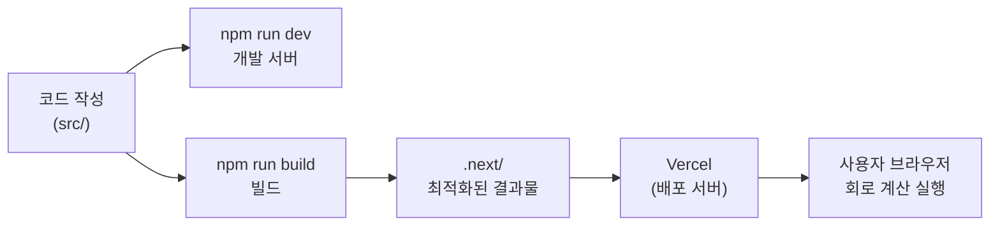

- **빌드**: 사람이 읽기 좋게 쓴 코드를, 브라우저가 빠르게 받을 수 있도록 압축하고 합치는 과정입니다.
- **배포**: 빌드 결과를 인터넷에서 접속할 수 있는 서버에 올리는 것입니다. 이 프로젝트는 **Vercel**에 배포할 예정입니다.

> **확인 문제**: `dependencies`와 `devDependencies`의 차이는 무엇일까요?

---

## 3. 폴더 구조와 계층 나누기

```
src/
  app/                    Next.js 페이지와 전역 스타일, 아이콘
  components/editor/      화면 (React 컴포넌트)
    nodes/                캔버스 위 부품 하나하나
    edges/                부품 사이의 선
  lib/circuit/            순수 로직 (화면과 무관한 계산)
  store/                  상태 저장소 (zustand)
docs/                     지금 읽고 있는 문서
```

이 프로젝트는 코드를 **계층**으로 나눕니다. 아래로 갈수록 화면과 멀고 단순합니다.

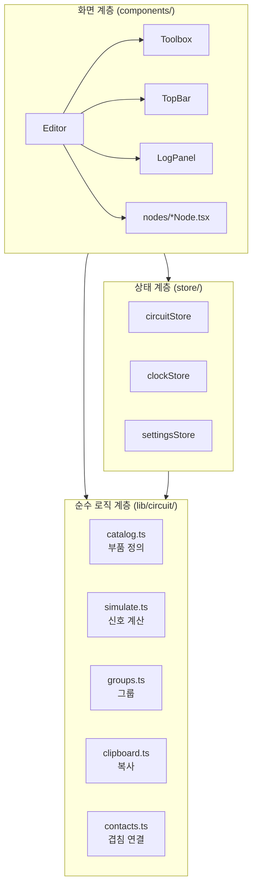

**왜 나눌까요?**

- `lib/circuit/`의 함수는 **순수 함수**입니다. 같은 입력에는 항상 같은 결과를 돌려주고, 화면이나 다른 상태를 건드리지 않습니다. 그래서 테스트하기 쉽고(12장), 나중에 다른 화면(예: 모바일 앱)에서도 그대로 쓸 수 있습니다.
- 화면 코드는 "무엇을 보여줄지"에만 집중하고, 복잡한 계산은 로직 계층에 맡깁니다.
- 화살표는 한 방향입니다. 로직은 화면을 모릅니다. 이렇게 **의존 방향**을 지키면 한 곳을 고쳐도 다른 곳이 덜 깨집니다.

> **확인 문제**: `simulate()` 함수가 React를 import하지 않는 이유는 무엇일까요?

---

## 4. Next.js

**Next.js**는 React로 웹사이트를 만들 때 필요한 것들(페이지 나누기, 빌드, 최적화)을 한데 묶어 놓은 **프레임워크**입니다.

### App Router: 폴더가 곧 주소

`src/app/` 폴더 구조가 그대로 웹 주소가 됩니다.

| 파일 | 역할 |
|---|---|
| [app/layout.tsx](../src/app/layout.tsx) | 모든 페이지를 감싸는 틀 (`<html>`, `<body>`, 글꼴, 제목) |
| [app/page.tsx](../src/app/page.tsx) | `/` 주소의 내용 |
| `app/icon.png`, `favicon.ico` | 파일을 두기만 하면 브라우저 탭 아이콘으로 쓰임 |

나중에 대시보드를 만들면 `app/dashboard/page.tsx`를 추가하는 것만으로 `/dashboard` 주소가 생깁니다.

```tsx
// src/app/page.tsx — 페이지는 편집기 하나만 보여 준다
import Editor from "@/components/editor/Editor";

export default function Home() {
  return <Editor />;
}
```

`@/`는 `src/`를 가리키는 줄임말(**경로 별칭**)입니다. `../../components/…`처럼 길게 쓰지 않아도 됩니다.

### 서버 컴포넌트와 클라이언트 컴포넌트

Next.js의 컴포넌트는 기본적으로 **서버 컴포넌트**입니다. 서버에서 HTML로 미리 그려서 보내 줍니다.
하지만 클릭, 키보드, 타이머처럼 **브라우저에서 반응해야 하는** 코드는 파일 맨 위에 `"use client"`를 붙여 **클라이언트 컴포넌트**로 만들어야 합니다.

```tsx
// src/components/editor/Editor.tsx
"use client";   // ← 이 파일과 여기서 불러오는 컴포넌트는 브라우저에서 동작

import { useState } from "react";
…
```

이 프로젝트의 편집기는 거의 모든 부분이 사용자의 조작에 반응하므로 클라이언트 컴포넌트입니다.

### 빌드 결과 읽기

`npm run build`를 하면 마지막에 이런 표가 나옵니다.

```
Route (app)
┌ ○ /
├ ○ /apple-icon.png
└ ○ /icon.png

○  (Static)  prerendered as static content
```

`○ (Static)`은 페이지를 빌드할 때 미리 만들어 두었다는 뜻입니다(**정적 페이지**). 요청마다 서버가 계산할 필요가 없어 매우 빠르고, Vercel에서 비용도 거의 들지 않습니다.

### 하이드레이션 주의

서버에서 미리 그린 HTML을 브라우저가 받으면, React가 그 위에 이벤트(클릭 등)를 연결합니다. 이것을 **하이드레이션**이라고 합니다.
이때 서버가 그린 화면과 브라우저가 처음 그린 화면이 **같아야** 합니다. 서버에는 브라우저 저장소(`localStorage`)가 없으므로, 저장해 둔 설정을 처음부터 읽어 그리면 두 화면이 달라져 경고가 납니다.
그래서 설정은 화면이 뜬 **다음에** 불러옵니다(10.9절).

> **확인 문제**: `"use client"`를 빼면 `Editor.tsx`에서 어떤 오류가 날까요? 직접 지워 보고 `npm run build`로 확인해 보세요. (확인한 뒤에는 되돌려 두세요)

---

## 5. React 핵심

### 컴포넌트와 JSX

**컴포넌트**는 화면 조각을 만드는 함수입니다. HTML처럼 생긴 **JSX** 문법으로 무엇을 그릴지 돌려줍니다.

```tsx
// src/components/editor/nodes/LedNode.tsx (간단히)
function LedNode({ id, data, selected }: NodeProps<CircuitNode>) {
  const lit = useSignal(id);               // 이 LED에 신호가 들어오는가?
  return (
    <NodeFrame data={data} selected={selected} title={lit ? "켜짐" : "꺼짐"}>
      <LedShape lit={lit} className="h-full w-full" />
    </NodeFrame>
  );
}
```

- `{ id, data, selected }`는 부모가 넘겨준 값, 즉 **props**입니다.
- `{lit ? "켜짐" : "꺼짐"}`처럼 중괄호 안에는 JavaScript 식을 쓸 수 있습니다.
- 컴포넌트는 다른 컴포넌트를 품을 수 있습니다(`NodeFrame` 안에 `LedShape`).

### props: 부모가 자식에게 넘기는 값

```tsx
// Editor.tsx (부모)
<TopBar
  componentCount={nodes.length}
  logOpen={logOpen}
  onToggleLog={() => setLogOpen((open) => !open)}
  …
/>

// TopBar.tsx (자식)
export default function TopBar({ componentCount, logOpen, onToggleLog, … }: TopBarProps) {
  return <button onClick={onToggleLog}>로그 보기</button>;
}
```

자식(`TopBar`)은 "로그를 열어라"를 스스로 하지 않고, 부모가 넘겨준 함수(`onToggleLog`)를 부를 뿐입니다. 상태는 부모가 가지고, 자식은 보여 주고 알리기만 합니다. 이렇게 하면 같은 상태를 여러 자식이 함께 쓸 수 있습니다.

### state: 바뀌면 화면이 다시 그려지는 값

```tsx
const [logOpen, setLogOpen] = useState(false);
```

- `logOpen`: 현재 값
- `setLogOpen`: 값을 바꾸는 함수. 이 함수로 바꾸면 React가 컴포넌트를 **다시 렌더링**합니다.
- 일반 변수(`let open = false`)를 바꾸면 화면은 바뀌지 않습니다. React가 변화를 모르기 때문입니다.

### 훅(Hook) 모음

`use`로 시작하는 함수를 **훅**이라고 합니다. 컴포넌트에 기능을 "걸어" 줍니다. 이 프로젝트에서 실제로 쓰인 예시는 이렇습니다.

| 훅 | 하는 일 | 이 프로젝트의 예 |
|---|---|---|
| `useState` | 바뀌면 다시 그리는 값 | 로그 창 열림 여부, 도구상자 넓이 |
| `useEffect` | 그린 **뒤에** 할 일 (이벤트 등록, 타이머) | 단축키 등록, 클럭 타이머 |
| `useLayoutEffect` | 그린 직후, 화면에 보이기 **전에** 할 일 | 도구상자 넓이가 바뀔 때 화면 위치 보정 |
| `useMemo` | 무거운 계산 결과를 기억해 두기 | 회로 시뮬레이션 결과 |
| `useCallback` | 함수를 기억해 두기 (매번 새로 만들지 않기) | 드롭, 클릭 처리 함수 |
| `useRef` | 다시 그리지 않아도 되는 값, DOM 요소 잡기 | 캔버스 영역 요소, 이전 넓이 |
| `useContext` | 멀리 있는 부모의 값 꺼내 쓰기 | 시뮬레이션 결과 |

#### useEffect 예: 단축키 등록과 정리

```tsx
// Editor.tsx
useEffect(() => {
  const onKeyDown = (event: KeyboardEvent) => { … };
  window.addEventListener("keydown", onKeyDown);            // 등록
  return () => window.removeEventListener("keydown", onKeyDown); // 정리
}, []);
```

`return`으로 돌려주는 함수는 컴포넌트가 사라질 때(또는 다시 실행되기 전에) 호출됩니다. 등록한 것은 반드시 정리해야 같은 이벤트가 여러 번 등록되는 버그를 막을 수 있습니다.
마지막의 `[]`는 **의존성 배열**입니다. 비어 있으면 처음 한 번만 실행되고, `[a, b]`라면 `a`나 `b`가 바뀔 때마다 다시 실행됩니다.

#### useMemo 예: 꼭 필요할 때만 다시 계산하기

```tsx
// Editor.tsx (간단히)
const simKey = JSON.stringify({ nodes: …종류와 on 값만…, edges: … });
const simulation = useMemo(() => simulate(…), [simKey]);
```

부품을 끄는 동안에는 위치가 1초에 수십 번 바뀝니다. 그때마다 회로를 다시 계산하면 낭비입니다.
그래서 **계산에 필요한 값(부품 종류, 켜짐 여부, 연결)만** 문자열 키로 만들고, 그 키가 바뀔 때만 다시 계산합니다. 위치만 바뀌면 키가 같으므로 이전 결과를 그대로 씁니다.

#### Context: 여러 단계를 건너뛰어 값 전달하기

시뮬레이션 결과는 `Editor`가 계산하지만, 실제로 쓰는 곳은 캔버스 깊숙한 곳의 LED, 게이트, 선입니다. props로 한 단계씩 넘기면 번거로우므로 **Context**를 씁니다.

```tsx
// SimulationContext.tsx
const SimulationContext = createContext<SimulationState>(기본값);
export const SimulationProvider = SimulationContext.Provider;
export function useSignal(nodeId: string) {
  return useContext(SimulationContext).outputs[nodeId] ?? false;
}

// Editor.tsx — 위에서 한 번 넣어 주면
<SimulationProvider value={simulation}> … </SimulationProvider>

// LedNode.tsx — 아래 어디서든 꺼내 쓴다
const lit = useSignal(id);
```

### 렌더링과 memo

React는 상태가 바뀌면 그 컴포넌트와 자식들을 다시 그립니다. 부품이 수백 개라면 하나만 바뀌어도 전부 다시 그리는 것은 아깝습니다.
`memo(LedNode)`처럼 감싸 두면 **props가 바뀌지 않은 컴포넌트는 다시 그리지 않습니다**. 부품 노드 파일 맨 아래의 `export default memo(…)`가 그 역할을 합니다.

> **확인 문제**: `useEffect`에서 정리 함수를 빼먹으면 어떤 일이 생길까요? 단축키 예로 설명해 보세요.

---

## 6. 상태 관리: zustand

### 왜 따로 저장소가 필요할까

`useState`는 컴포넌트 하나 안의 값입니다. 그런데 회로 데이터(부품, 선)는 캔버스, 도구상자 목록, 로그, 상단바가 **모두** 함께 씁니다. 이렇게 여러 곳에서 함께 쓰는 값은 컴포넌트 바깥의 **저장소**에 둡니다.
이 프로젝트는 가볍고 쉬운 **zustand**를 씁니다.

### 세 개의 저장소

| 저장소 | 담는 것 | 저장 여부 |
|---|---|---|
| [circuitStore](../src/store/circuitStore.ts) | 부품, 선, 되돌리기 기록, 클립보드 | 회로 데이터 (나중에 파일·DB로 저장 예정) |
| [clockStore](../src/store/clockStore.ts) | 클럭의 현재 레벨과 변화 기록 | 저장 안 함 (실행 중에만 의미 있는 값) |
| [settingsStore](../src/store/settingsStore.ts) | 그룹 점선 표시, LED 색 | 브라우저(localStorage)에 저장 |

"저장할 데이터"와 "실행 중에만 의미 있는 데이터"를 나눈 것이 핵심입니다. 클럭 레벨은 0.5초마다 바뀌는데, 이것을 회로 데이터에 넣으면 저장할 때마다 쓸데없는 값이 들어가고 되돌리기 기록도 엉망이 됩니다.

### 저장소 만들기와 쓰기

```ts
// 만들기 (간단히)
export const useCircuitStore = create<CircuitState>((set, get) => ({
  nodes: [],
  edges: [],
  toggle: (id) =>
    set((state) => ({
      nodes: state.nodes.map((n) =>
        n.id === id ? { ...n, data: { ...n.data, on: !n.data.on } } : n,
      ),
    })),
  …
}));

// 쓰기: 필요한 값만 골라서 구독한다
const nodes = useCircuitStore((s) => s.nodes);
const toggle = useCircuitStore((s) => s.toggle);
```

`(s) => s.nodes`처럼 저장소에서 필요한 값만 고르는 함수를 **선택자**(selector)라고 합니다. 고른 값이 바뀔 때만 컴포넌트가 다시 그려집니다.

### 불변성: 고치지 말고 새로 만들기

위 `toggle`에서 `n.data.on = !n.data.on`처럼 직접 고치지 않고, `{ ...n, data: { ...n.data, on: … } }`로 **새 객체**를 만들었습니다. 이것을 **불변성**을 지킨다고 합니다.

- React와 zustand는 "객체가 바뀌었는가?"를 **주소(참조)가 같은가**로 빠르게 판단합니다.
- 직접 고치면 주소가 그대로라 변화를 알아채지 못해 화면이 안 바뀝니다.
- 덕분에 되돌리기도 쉬워집니다. 예전 배열을 그대로 보관해 두기만 하면 되기 때문입니다(10.6절).

`...`은 **전개 문법**으로, 객체나 배열을 펼쳐서 복사합니다.

### 실제로 있었던 버그: 무한 렌더링

선택 도구 모음을 처음 만들었을 때 페이지가 아예 열리지 않았습니다. 오류는 `Minified React error #185`(최대 업데이트 깊이 초과), 즉 **무한 렌더링**이었습니다.

```ts
// ❌ 문제가 된 코드
const { selected } = useCircuitStore(
  useShallow((s) => ({ selected: s.nodes.filter((n) => n.selected) })),
);
```

`filter`는 부를 때마다 **새 배열**을 만듭니다. zustand는 "선택자 결과가 바뀌었다"고 판단해 다시 그리고, 다시 그리면 또 새 배열이 생기고… 이 과정이 끝없이 반복됐습니다.

```ts
// ✅ 고친 코드: 저장소에서는 원본만 꺼내고, 걸러내기는 렌더링 안에서
const allNodes = useCircuitStore((s) => s.nodes);
const selected = allNodes.filter((n) => n.selected);
```

**교훈**: 선택자 안에서 `filter`, `map`, `{…}`처럼 새 값을 만들지 않습니다.

> **확인 문제**: 클럭 레벨을 `circuitStore`의 노드 데이터에 넣으면 되돌리기(Ctrl+Z)가 어떻게 동작하게 될까요?

---

## 7. React Flow: 노드와 선

**React Flow**(`@xyflow/react`)는 노드를 놓고 선으로 잇는 편집기를 만드는 라이브러리입니다. 확대/축소, 화면 이동, 끌기, 선 그리기를 대신 해 줍니다.

### 세 가지 기본 개념

| 개념 | React Flow 이름 | 이 프로젝트에서 |
|---|---|---|
| 노드 | Node | 부품 (게이트, LED, 전원 …) |
| 선 | Edge | 부품 사이의 전선 |
| 연결점 | Handle | 부품의 입력점·출력점 (동그라미) |

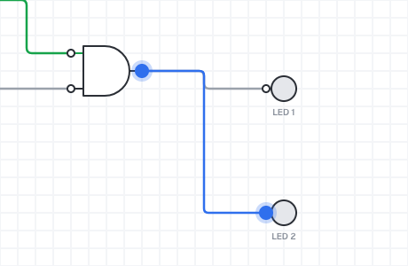

AND 게이트의 출력 연결점(파란 점)에서 끌어서 LED 2의 입력점에 잇는 중입니다. 마우스를 올린 연결점은 커지고 파랗게 바뀝니다. 이 모양은 [globals.css](../src/app/globals.css)의 `.cd-handle:hover` 규칙으로 만들었습니다.

### 노드와 선의 데이터 모양

```ts
// 노드 하나
{
  id: "and-3f9a1c2b",
  type: "gate",                     // 어떤 컴포넌트로 그릴지
  position: { x: 240, y: 120 },     // 캔버스 좌표
  data: { kind: "AND", on: false, label: "AND 1" },
  selected: false,
}

// 선 하나
{
  id: "power-…:out->and-…:in0",
  type: "wire",
  source: "power-…",  sourceHandle: "out",   // 어디서
  target: "and-…",    targetHandle: "in0",   // 어디로
}
```

연결점 이름은 규칙을 정해 두었습니다. 입력은 `in0`, `in1`, …이고 출력은 `out`입니다([types.ts](../src/lib/circuit/types.ts)).

### 제어 컴포넌트 방식

React Flow는 노드와 선을 **우리 저장소에서 받아서** 그립니다. 사용자가 무언가를 바꾸면 React Flow는 직접 고치지 않고 "이렇게 바꾸고 싶어요"라는 **변경 목록**(changeset)을 우리에게 넘깁니다.

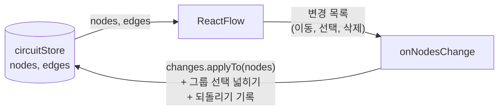

```ts
// circuitStore.ts (간단히)
onNodesChange: (changes) =>
  set((state) => {
    // 삭제나 끌기 시작이면 되돌리기 기록을 남긴다
    …
    const nodes = changes.applyTo(state.nodes);           // 변경 적용
    return { nodes: expandGroupSelection(nodes, …) };     // 그룹이면 함께 선택
  }),
```

이 방식을 **제어 컴포넌트**(controlled component)라고 합니다. 변경이 반드시 우리 코드를 거치므로, 그 사이에 "그룹이면 같이 선택", "되돌리기 기록 남기기" 같은 규칙을 끼워 넣을 수 있습니다.

### 직접 만든 노드 컴포넌트

`nodeTypes`에 "이 type이면 이 컴포넌트로 그려라"를 등록합니다.

```tsx
// Editor.tsx
const nodeTypes = { gate: GateNode, power: PowerNode, switch: SwitchNode, led: LedNode, clock: ClockNode };
```

모든 부품은 공통 틀인 [NodeFrame](../src/components/editor/nodes/NodeFrame.tsx)을 씁니다. 이 틀이 하는 일은 다음과 같습니다.
1. 크기 배율(×1 ~ ×4)에 맞춰 부품을 키운다
2. 연결점을 격자에 맞는 위치에 놓는다 ([Ports.tsx](../src/components/editor/nodes/Ports.tsx))
3. 이름표(LED 1 …)를 붙인다
4. 그룹 부품을 누르면 끌기가 시작되기 전에 그룹 전체를 선택한다

### 화면 좌표와 캔버스 좌표

캔버스는 이동하고 확대할 수 있으므로 좌표가 두 가지입니다.

- **화면 좌표**: 브라우저 창 왼쪽 위를 (0, 0)으로 한 픽셀 위치 (마우스 이벤트의 `clientX`, `clientY`)
- **캔버스 좌표**: 회로가 놓인 세상의 위치 (노드의 `position`)

도구상자에서 부품을 끌어다 놓을 때는 마우스의 화면 좌표를 캔버스 좌표로 바꿔야 합니다.

```ts
// Editor.tsx
addAt(kind, screenToFlowPosition({ x: event.clientX, y: event.clientY }));
```

**뷰포트**는 "지금 캔버스의 어느 부분을 얼마나 확대해서 보고 있는가"(`x`, `y`, `zoom`)입니다. 화면 좌표 = 캔버스 좌표 × zoom + 뷰포트 위치입니다.

> **확인 문제**: 확대(zoom)가 2일 때 캔버스에서 100px 떨어진 두 부품은 화면에서 몇 px 떨어져 보일까요?

---

## 8. 논리 회로와 시뮬레이션

### 논리 게이트와 진리표

디지털 회로의 신호는 0(꺼짐)과 1(켜짐) 두 가지뿐입니다. **논리 게이트**는 입력 신호를 받아 정해진 규칙대로 출력을 냅니다. 그 규칙을 모두 적은 표가 **진리표**입니다.

| A | B | AND | OR | NAND | NOR | XOR | XNOR |
|:-:|:-:|:-:|:-:|:-:|:-:|:-:|:-:|
| 0 | 0 | 0 | 0 | 1 | 1 | 0 | 1 |
| 0 | 1 | 0 | 1 | 1 | 0 | 1 | 0 |
| 1 | 0 | 0 | 1 | 1 | 0 | 1 | 0 |
| 1 | 1 | 1 | 1 | 0 | 0 | 0 | 1 |

NOT은 입력이 하나이고 반대로 뒤집습니다(0 → 1, 1 → 0). 기호 끝의 작은 동그라미(○)는 "뒤집는다"는 뜻입니다. 그래서 NAND = AND + ○입니다.

코드로는 이렇게 씁니다([catalog.ts](../src/lib/circuit/catalog.ts)).

```ts
export function evaluate(kind: ComponentKind, inputs: boolean[], on: boolean): boolean {
  const [a = false, b = false] = inputs;   // 연결 안 된 입력은 false(0)
  switch (kind) {
    case "POWER":
    case "CLOCK":  return on;              // 스스로 신호를 내는 부품
    case "SWITCH": return on && a;         // 닫혀 있을 때만 통과
    case "LED":    return a;
    case "AND":    return a && b;
    case "OR":     return a || b;
    case "NOT":    return !a;
    case "NAND":   return !(a && b);
    case "NOR":    return !(a || b);
    case "XOR":    return a !== b;
    case "XNOR":   return a === b;
  }
}
```

### 회로 전체 계산하기: simulate()

게이트 하나는 쉽지만, 회로 전체는 어떤 순서로 계산해야 할까요? 앞 게이트의 출력이 뒤 게이트의 입력이 되기 때문입니다.
이 프로젝트는 **반복 계산**으로 해결합니다([simulate.ts](../src/lib/circuit/simulate.ts)).

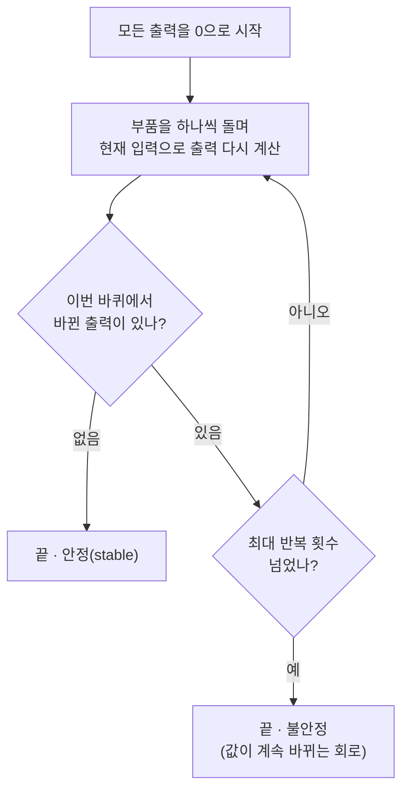

```ts
export function simulate(nodes: SimNode[], edges: SimEdge[]): SimResult {
  // 1) 각 부품의 입력 포트에 어떤 부품이 연결됐는지 정리
  const drivers = new Map<string, (string | undefined)[]>();
  …
  // 2) 모든 출력을 0으로 시작
  const outputs: Record<string, boolean> = {};
  for (const node of nodes) outputs[node.id] = false;

  // 3) 바뀌는 값이 없을 때까지 반복
  const maxIterations = nodes.length * 2 + 10;
  for (let i = 0; i < maxIterations; i++) {
    let changed = false;
    for (const node of nodes) {
      const inputs = …연결된 부품의 현재 출력…;
      const next = evaluate(node.kind, inputs, node.on);
      if (outputs[node.id] !== next) { outputs[node.id] = next; changed = true; }
    }
    if (!changed) return { outputs, stable: true };
  }
  return { outputs, stable: false };
}
```

#### 직접 따라가 보기

전원(켜짐) → NOT → LED 회로를 **LED, NOT, 전원** 순서로 계산한다고 해 봅시다.

| 바퀴 | LED | NOT | 전원 | 바뀐 것? |
|:-:|:-:|:-:|:-:|:-:|
| 시작 | 0 | 0 | 0 | |
| 1 | 0 (NOT=0) | 1 (전원=0) | 1 | 예 |
| 2 | 1 (NOT=1) | 0 (전원=1) | 1 | 예 |
| 3 | 0 (NOT=0) | 0 | 1 | 예 |
| 4 | 0 | 0 | 1 | 아니오 → 끝 |

결과적으로 LED = 0입니다. 순서가 나빠도 몇 바퀴 돌면 맞는 값에 도착합니다. 한 바퀴 안에서 방금 바뀐 값을 바로 다음 부품이 쓰는 방식을 **가우스-자이델 방식**이라고 합니다.

### 되먹임(피드백)과 불안정

출력이 다시 자기 입력으로 돌아오는 회로를 **되먹임 회로**라고 합니다.

- **NOT 게이트의 출력을 자기 입력에 연결하면**: 0 → 1 → 0 → 1 … 끝없이 바뀝니다. 최대 반복 횟수를 넘기면 `stable: false`가 되고, 상단바에 "⚠ 회로가 불안정합니다"가 뜹니다.
- **NOR 게이트 두 개로 만든 SR 래치**는 되먹임이 있어도 한 값으로 자리를 잡습니다. 이것이 1비트를 기억하는 메모리의 기초입니다. 테스트 파일 [simulate.test.ts](../src/lib/circuit/simulate.test.ts)에 예시가 있습니다.

### LED 상태를 저장하지 않는 이유

1장 확인 문제의 답입니다. LED가 켜졌는지는 회로(부품과 연결)만 알면 **언제든 계산할 수 있는 값**입니다. 이런 값을 **파생 상태**라고 합니다.
파생 상태를 따로 저장하면 원래 데이터와 어긋날 위험이 생깁니다(예: 선을 지웠는데 LED는 여전히 켜짐으로 저장됨). 그래서 저장하지 않고 매번 계산합니다.

> **확인 문제**: XOR 게이트를 AND, OR, NOT만으로 만들 수 있을까요? 캔버스에서 직접 만들어 보세요.

---

## 9. 격자에 맞춘 설계

### 문제: 선이 일자로 안 이어진다

초기 버전에서는 게이트 출력점이 25px 높이, LED 입력점이 20px 높이에 있었습니다. 어떻게 옮겨도 두 점이 같은 높이에 올 수 없어서 선이 항상 살짝 꺾였습니다.

### 해결: 모든 것을 격자 한 칸(20px)의 배수로

1. 부품 크기를 격자 칸 수로 정한다
2. 연결점 높이도 칸 수로 정한다
3. 부품을 격자 한 칸 단위로만 놓이게 한다 (`snapGrid={[20, 20]}`)

그러면 모든 연결점이 **항상 격자선 위**에 있으므로, 같은 줄에 놓기만 하면 선이 일자가 됩니다.

| 부품 | 크기(칸) | 입력점 높이(칸) | 출력점 높이(칸) |
|---|---|---|---|
| 2입력 게이트 | 4 × 4 | 1, 3 | 2 |
| NOT | 4 × 2 | 1 | 1 |
| 전원, LED | 2 × 2 | 1 (LED) | 1 (전원) |
| 스위치 | 3 × 2 | 1 | 1 |
| 클럭 | 5 × 2 | — | 1 |

이 표는 코드에서 [catalog.ts](../src/lib/circuit/catalog.ts)의 `size`, `inputYs`, `outputY`로 정의되어 있습니다. 숫자를 한곳에서 관리하니 그림 그리기, 연결점 배치, 겹침 판정이 모두 같은 값을 씁니다. 이렇게 한 곳에만 두는 것을 **단일 진실 공급원**이라고 합니다.

### 실제로 있었던 버그: CSS 테두리가 연결점을 2px 밀었다

클럭만 연결점이 2px 어긋나 있었습니다. 클럭 상자에 `border: 2px`를 줬는데, 안쪽에 절대 위치로 놓인 요소(연결점)는 **테두리 안쪽**을 기준으로 위치가 정해지기 때문입니다.
테두리를 `box-shadow: inset 0 0 0 2px …`(안쪽 그림자)로 바꿔 해결했습니다. 그림자는 배치에 영향을 주지 않습니다.

### 크기 배율과 그룹 확대

부품을 ×2로 키우면 크기와 연결점 위치가 모두 2배가 되어 여전히 격자 위에 있습니다.
그런데 그룹을 키울 때 **부품 크기만** 커지고 사이 거리는 그대로라, 부품끼리 점점 가까워지는 문제가 있었습니다. 지금은 선택 영역의 왼쪽 위를 기준으로 **거리도 같은 비율로** 늘립니다.

| ×1 | ×2 |
|---|---|
| 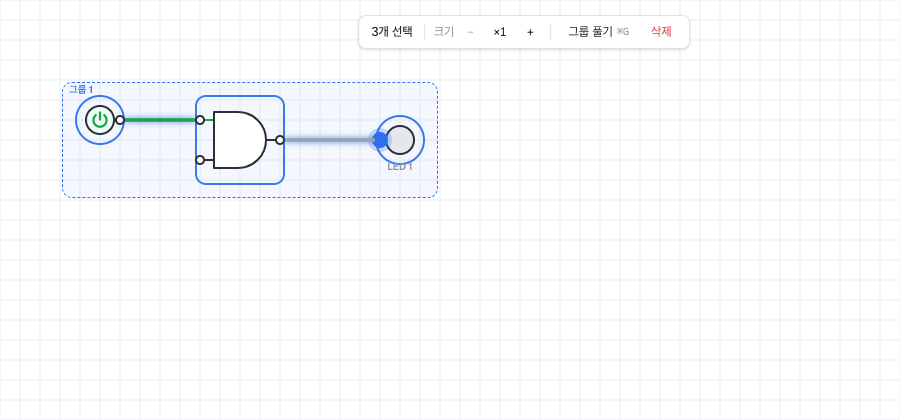 | 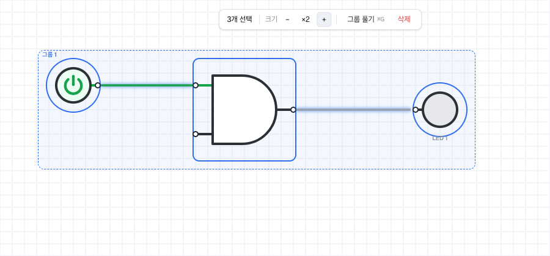 |

```ts
// circuitStore.ts — changeSelectedScale (간단히)
const factor = 새배율 / 원래배율;                 // 예: ×1 → ×2 이면 2
const anchorX = Math.min(...selected.map((n) => n.position.x));  // 기준점
x: snap(anchorX + (n.position.x - anchorX) * factor)            // 기준점에서의 거리 × 비율
```

> **확인 문제**: ×2에서 ×3으로 키우면 비율은 1.5입니다. 40px 떨어진 부품은 60px이 되어 격자(20px)에 맞지만, 20px 떨어진 부품은 어떻게 될까요? `snap()`이 하는 일을 생각해 보세요.

---

## 10. 기능별 구현 해설

### 10.1 도구상자에서 부품 꺼내기

두 가지 방법을 지원합니다.

- **클릭**: 지금 보이는 캔버스의 가운데에 놓습니다. 연달아 누르면 겹치지 않게 조금씩 비켜 놓습니다.
- **끌어다 놓기**: 브라우저 기본 기능인 **HTML5 드래그 앤 드롭**을 씁니다.

```tsx
// Toolbox.tsx — 끌기 시작할 때 "무슨 부품인지"를 실어 보낸다
event.dataTransfer.setData("application/x-cd-component", kind);

// Editor.tsx — 캔버스에 놓으면 꺼내서 추가
const kind = event.dataTransfer.getData("application/x-cd-component");
if (!isComponentKind(kind)) return;          // 엉뚱한 것이 끌려오면 무시
addAt(kind, screenToFlowPosition({ x: event.clientX, y: event.clientY }));
```

`isComponentKind`처럼 "이 값이 정말 그 타입인가?"를 확인하는 함수를 **타입 가드**라고 합니다. 바깥에서 들어온 값은 항상 의심하고 확인합니다.

### 10.2 선 연결 규칙

아무렇게나 이으면 안 되므로 규칙을 검사합니다([circuitStore.ts](../src/store/circuitStore.ts) `isValidConnection`).

1. 자기 자신에게는 연결하지 않는다
2. 출력(`out`)에서 입력(`inN`)으로만 연결한다
3. 입력 하나에는 선 하나만 연결한다 (신호가 두 군데서 오면 어느 값을 쓸지 모호하므로)

검사를 통과하지 못하면 끌고 있는 연결점이 빨갛게 바뀌고 연결되지 않습니다.

### 10.3 겹침 연결: 선 없이 점끼리 닿으면 연결

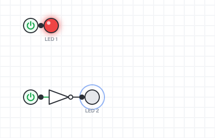

위: 전원 출력점과 LED 입력점이 겹쳐서 LED가 켜졌습니다. 아래: 전원 → NOT → LED가 겹쳐 있고, NOT이 1을 0으로 뒤집어 LED는 꺼져 있습니다. 겹쳐 연결된 점은 검게 채워집니다.

```ts
// contacts.ts — findContactEdges (간단히)
// 1) 모든 출력점의 위치를 "x,y" 문자열 키로 지도(Map)에 담는다
outputAt.set(`${x},${y}`, 부품id);
// 2) 각 입력점 위치로 지도를 찾아, 같은 자리에 출력점이 있으면 연결로 본다
const source = outputAt.get(`${input.x},${input.y}`);
if (source && 선이_없으면) contacts.push({ source, target: 이부품, … });
```

부품이 n개일 때 모든 쌍을 비교하면 n × n번이지만, **Map**(해시 맵)을 쓰면 n번 정도로 끝납니다. 이렇게 데이터 구조를 잘 고르면 빨라집니다.

찾아낸 "보이지 않는 선"은 진짜 선과 합쳐서 시뮬레이션에 넣습니다. 그래서 시뮬레이션 코드는 겹침 연결이 있는지조차 모릅니다. 기존 코드를 고치지 않고 **입력을 바꿔서** 기능을 더한 좋은 예입니다.

### 10.4 클럭과 로그 그래프

**클럭**은 `setInterval`로 주기의 절반마다 레벨을 뒤집습니다([useClockRunner.ts](../src/components/editor/useClockRunner.ts)).

```ts
const timer = window.setInterval(() => flip(id, performance.now()), period / 2);
return () => window.clearInterval(timer);   // 클럭이 지워지거나 주기가 바뀌면 정리
```

레벨이 바뀔 때마다 `{ 시각, 레벨 }`을 기록해 두고, 로그 패널의 [ClockGraph](../src/components/editor/ClockGraph.tsx)가 이 기록으로 **SVG** 경로를 그립니다.

```
M0,31 H40 V5 H80 V31 H120 …
```

SVG 경로 명령은 `M`(이 점으로 이동), `H`(가로로 그리기), `V`(세로로 그리기)입니다. 레벨이 바뀌는 시각마다 가로로 가다가 세로로 꺾으면 사각파 모양이 됩니다.

### 10.5 선택과 그룹

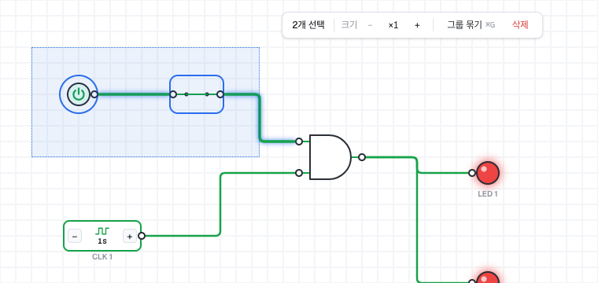

배경을 끌면 선택 상자가 생기고, 상자에 걸친 부품이 선택됩니다. 선택하면 위쪽에 도구 모음이 나타납니다.

**그룹 데이터 모델**: 그룹을 따로 저장하지 않고, 각 부품에 "나는 어느 그룹들에 속해 있나"를 **바깥에서 안쪽 순서**로 적어 둡니다.

```
전원 1:  groupPath = ["group-3", "group-1"]
LED 1:   groupPath = ["group-3", "group-1"]
AND 1:   groupPath = ["group-3", "group-2"]
OR 1:    groupPath = ["group-3", "group-2"]
NOT 1:   groupPath = 없음
```

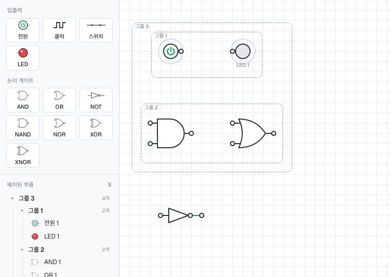

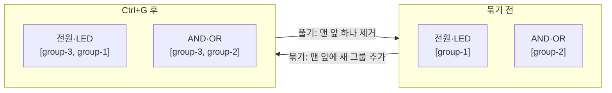

- **묶기**: 선택한 부품들의 경로 **맨 앞에** 새 그룹을 붙인다
- **풀기**: 경로의 **맨 앞 하나만** 뗀다 → 안쪽 그룹이 그대로 되살아난다
- **선택**: 부품 하나를 누르면 경로 맨 앞(가장 바깥 그룹)이 같은 부품을 모두 선택한다

이 단순한 규칙 하나로 여러 겹 중첩이 모두 해결됩니다. 화면에 그릴 때는 이 경로들을 [buildGroupTree](../src/lib/circuit/groups.ts)로 **트리**(나무 구조)로 바꿔서, 도구상자 목록과 점선 상자를 그립니다.

**까다로웠던 점**: 선택 안 된 그룹 부품을 바로 끌면 그 부품만 움직였습니다. React Flow가 "무엇을 끌지"를 정하는 시점이 그룹 선택이 반영되는 시점보다 빨랐기 때문입니다. 마우스를 **누르는 순간**(`onPointerDownCapture`) 그룹 전체를 먼저 선택하도록 해서 해결했습니다. 이벤트가 언제, 어떤 순서로 일어나는지 아는 것이 중요합니다.

### 10.6 되돌리기 / 다시 실행

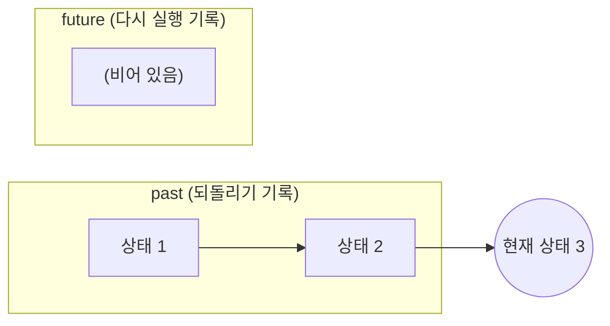

- 무언가 바꾸기 **직전**에 현재 상태(`nodes`, `edges`)를 `past`에 쌓습니다 → `checkpoint()`
- **Ctrl+Z**: `past`에서 하나 꺼내 현재로 만들고, 지금 상태는 `future`에 쌓습니다
- **Ctrl+Shift+Z**: 반대로 `future`에서 꺼냅니다
- 새로운 변경을 하면 `future`는 비웁니다 (갈라진 미래는 버림)

불변성(6장) 덕분에 상태를 통째로 복사할 필요 없이 **배열 참조만** 보관하면 됩니다. 메모리를 거의 쓰지 않습니다.

**세부 규칙**

- 부품을 지우면 연결된 선도 지워지는데, React Flow는 이것을 "부품 삭제"와 "선 삭제" 두 번으로 나눠 알려 줍니다. 같은 순간에 들어온 변경은 기록 하나로 합칩니다(`queueMicrotask` 사용).
- 끌기는 위치가 수십 번 바뀌지만, **끌기 시작할 때 한 번만** 기록합니다.
- 선택 변경은 기록하지 않습니다. 선택만 바꿨는데 Ctrl+Z가 그걸 되돌리면 불편하기 때문입니다.

### 10.7 복사 · 붙여넣기 · 복제

[clipboard.ts](../src/lib/circuit/clipboard.ts)

- **복사**: 선택한 부품과, **양쪽 끝이 모두 선택된** 선만 복사합니다
- **붙여넣기**: 새 id를 만들고, 선의 `source`/`target`을 새 id로 바꿔 끼웁니다. 이름(AND 2…)과 그룹 번호도 새로 매깁니다. 붙일 때마다 2칸씩 더 비켜 놓습니다.
- **복제(Ctrl+D)**: 클립보드를 건드리지 않고 바로 복사본을 만듭니다

```ts
const idMap = new Map<string, string>();  // 옛 id → 새 id
…
source: idMap.get(e.source)!,   // 선의 양 끝을 새 부품으로 연결
target: idMap.get(e.target)!,
```

### 10.8 단축키와 한글 입력

```ts
switch (event.code) {           // event.key 가 아니라 event.code
  case "KeyC": store.copy(); break;
  case "KeyZ": event.shiftKey ? store.redo() : store.undo(); break;
  …
}
```

- `event.key`: 입력되는 **글자** (한글 자판이면 Ctrl+A가 `"ㅁ"`이 됨)
- `event.code`: 눌린 **물리적 키의 위치** (자판과 상관없이 `"KeyA"`)

한글 사용자를 위해 `event.code`를 씁니다. 그리고 입력창이나 설정 팝업 안에서 누른 키는 캔버스 단축키로 처리하지 않습니다.

### 10.9 설정과 브라우저 저장소

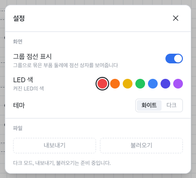

설정은 회로가 아니라 **보는 사람의 취향**이므로 회로 데이터가 아닌 브라우저의 **localStorage**에 저장합니다([settingsStore.ts](../src/store/settingsStore.ts)).

```ts
persist(
  (set) => ({ showGroupOutlines: true, ledColor: "red", … }),
  {
    name: "cd-settings",
    storage: createJSONStorage(() => safeLocalStorage), // 막혀 있어도 오류 없이
    skipHydration: true,                                // 처음엔 불러오지 않고
  },
);

// Editor.tsx — 화면이 뜬 뒤에 불러온다 (4장 하이드레이션 참고)
useEffect(() => { void useSettingsStore.persist.rehydrate(); }, []);
```

LED 색은 **CSS 변수** `--cd-led-on`을 바꿔서 적용합니다. 이 변수를 쓰는 모든 곳(캔버스 LED, 도구상자 아이콘, 로그의 빨간 점)이 한 번에 바뀝니다.

> **확인 문제**: 시크릿 창에서 localStorage가 막혀 있으면 설정은 어떻게 동작할까요? `safeLocalStorage`를 읽고 답해 보세요.

---

## 11. 스타일링

### Tailwind CSS

**Tailwind**는 미리 만들어진 작은 클래스들을 조합해 모양을 만드는 방식입니다.

```tsx
<button className="rounded-md border border-cd-border bg-cd-bg px-3 py-1 text-sm">
```

`rounded-md`(모서리 둥글게), `px-3`(좌우 여백), `text-sm`(작은 글자)처럼 이름만 봐도 모양을 알 수 있습니다. CSS 파일을 오가지 않고 컴포넌트 안에서 바로 모양을 정할 수 있는 것이 장점입니다.

### 색상 토큰 (CSS 변수)

색을 코드 곳곳에 직접 쓰지 않고, [globals.css](../src/app/globals.css)에 이름을 붙여 한 번만 정의합니다.

```css
:root {
  --cd-bg: #ffffff;        /* 배경 */
  --cd-wire-on: #16a34a;   /* 신호 1인 선 (초록) */
  --cd-led-on: #ef4444;    /* 켜진 LED */
  …
}
```

이렇게 해 두면 **다크 모드**를 만들 때 이 변수들의 값만 다시 정의하면 됩니다. 컴포넌트 코드는 하나도 고칠 필요가 없습니다.

### 실제로 있었던 버그: 직접 쓴 CSS가 Tailwind를 이겼다

그룹 목록 줄에 `className="cd-list-item p-0 gap-0"`을 줬는데 여백이 사라지지 않았습니다.
Tailwind 클래스는 CSS **계층(@layer)** 안에 들어가는데, `globals.css`에 직접 쓴 `.cd-list-item`은 계층 밖에 있습니다. CSS 규칙상 **계층 밖의 스타일이 계층 안의 스타일보다 우선**합니다. 그래서 `.cd-list-item`의 `padding`이 `p-0`을 이겼습니다.

**교훈**: 직접 만든 CSS 클래스와 Tailwind 클래스를 같은 속성에 섞어 쓰지 않습니다.

---

## 12. 테스트

### 왜 테스트를 쓸까

기능이 늘어나면 새 코드가 예전 기능을 망가뜨리기 쉽습니다(**회귀**). 테스트는 "이 함수는 이렇게 동작해야 한다"를 코드로 적어 두고, 명령 한 번으로 전부 확인하게 해 줍니다.

```bash
npm test
# Test Files  4 passed
#      Tests  47 passed
```

### 단위 테스트 (vitest)

**단위 테스트**는 함수 하나를 따로 떼어 검사합니다. 순수 함수는 입력만 넣으면 되니 테스트하기 아주 쉽습니다(3장).

```ts
// groups.test.ts
it("그룹 1과 그룹 2를 묶으면 그룹 3 안에 들어가고, 풀면 다시 그룹 1·2로 돌아온다", () => {
  const start = [
    node("a", ["group-1"], true), node("b", ["group-1"], true),
    node("c", ["group-2"], true), node("d", ["group-2"], true),
  ];
  const grouped = toggleGroup(start);
  expect(paths(grouped.nodes)).toEqual([
    ["group-3", "group-1"], ["group-3", "group-1"],
    ["group-3", "group-2"], ["group-3", "group-2"],
  ]);
  expect(paths(toggleGroup(grouped.nodes).nodes)).toEqual(paths(start));
});
```

테스트 이름을 **한글 문장으로** 쓰면, 실패했을 때 무엇이 깨졌는지 바로 알 수 있습니다.

| 테스트 파일 | 검사하는 것 |
|---|---|
| [simulate.test.ts](../src/lib/circuit/simulate.test.ts) | 진리표, 신호 전파, 불안정 감지, SR 래치 |
| [groups.test.ts](../src/lib/circuit/groups.test.ts) | 묶기/풀기, 중첩, 선택 넓히기, 트리 |
| [contacts.test.ts](../src/lib/circuit/contacts.test.ts) | 겹침 연결 판정 |
| [circuitStore.test.ts](../src/store/circuitStore.test.ts) | 되돌리기, 복사·붙여넣기, 그룹 크기 조절 |

### 브라우저 테스트

마우스로 끌기, 단축키처럼 실제 브라우저에서만 확인할 수 있는 것도 있습니다. 개발하면서 **Playwright**로 실제 Chrome을 띄워 "부품을 끌어 놓고 → 선을 잇고 → LED가 켜지는지"를 자동으로 확인했습니다. 이 문서의 화면 캡처도 그 방법으로 찍었습니다.

### 그 밖의 검사

| 명령 | 하는 일 |
|---|---|
| `npx tsc --noEmit` | 타입 오류 검사 |
| `npm run lint` | **ESLint**: 실수하기 쉬운 코드 패턴 검사 (예: 훅을 잘못 쓴 곳) |
| `npm run build` | 실제 배포와 같은 조건으로 빌드되는지 확인 |

---

## 13. Git 작업 흐름

**Git**은 코드의 변경 기록을 남기는 도구이고, **GitHub**는 그 기록을 인터넷에 올려 두는 곳입니다.

### 이 프로젝트의 규칙

- 개발은 `develop` 브랜치에서 한다
- 어느 정도 모이면 `main`에 합친다(merge)
- `main`은 배포되는 안정 버전이다

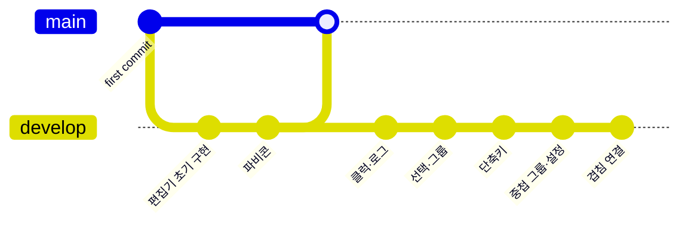

### 자주 쓰는 명령

| 명령 | 뜻 |
|---|---|
| `git status` | 무엇이 바뀌었는지 보기 |
| `git diff` | 바뀐 내용을 줄 단위로 보기 |
| `git add .` | 이번 커밋에 넣을 변경 고르기 |
| `git commit -m "메시지"` | 변경을 기록으로 남기기 |
| `git push` | 내 기록을 GitHub에 올리기 |
| `git log --oneline` | 지금까지의 기록 한 줄씩 보기 |
| `git checkout main` / `git merge develop` | main으로 가서 develop을 합치기 |

**좋은 커밋 메시지**는 "무엇을, 왜" 바꿨는지 적습니다. 이 프로젝트의 커밋 메시지를 `git log`로 읽어 보면 기능이 어떤 순서로 쌓였는지 알 수 있습니다. 그 자체로 좋은 교재입니다.

---

## 14. 연습 과제

쉬운 것부터 차례로 해 보세요. 각 과제를 하고 나면 `npm test`, `npm run lint`, `npm run build`로 확인합니다.

1. **LED 색 추가** ★
   [settingsStore.ts](../src/store/settingsStore.ts)의 `LED_COLORS`에 흰색을 추가해 보세요. 설정 팝업에 자동으로 나타나는지 확인합니다.
2. **클럭 주기 단계 추가** ★
   [catalog.ts](../src/lib/circuit/catalog.ts)의 `CLOCK_PERIODS`에 `10000`(10초)을 넣어 보세요.
3. **버퍼(BUF) 게이트 만들기** ★★
   입력을 그대로 내보내는 게이트입니다. `types.ts`의 `GateKind`, `catalog.ts`의 `CATALOG`·`evaluate`·`LABEL_PREFIX`, `shapes.tsx`의 모양을 차례로 추가해야 합니다. 타입스크립트가 빠뜨린 곳을 빨간 줄로 알려 주는 것을 경험해 보세요. 테스트도 하나 추가합니다.
4. **3입력 AND 게이트** ★★★
   입력이 3개면 게이트 높이와 입력점 위치를 어떻게 정해야 격자에 맞을까요? 9장의 표를 참고해 설계부터 해 보세요.
5. **내보내기 기능** ★★★
   스토어의 `getDocument()`가 이미 저장용 데이터(`CircuitDocument`)를 만들어 줍니다. 이것을 `JSON.stringify`로 문자열로 만들어 `.cdg` 파일로 내려받게 해 보세요. (힌트: `Blob`, `URL.createObjectURL`, `<a download>`)
6. **불러오기 기능** ★★★
   파일을 골라 읽고 `loadDocument()`에 넘깁니다. 이상한 파일이 들어오면 어떻게 막을지(`format`, `version` 확인)도 생각해 보세요.

---

## 15. 용어 사전

| 용어 | 뜻 |
|---|---|
| **App Router** | Next.js에서 `app/` 폴더 구조로 페이지 주소를 정하는 방식 |
| **CSS 변수** | `--이름: 값`으로 정의하고 `var(--이름)`으로 쓰는 CSS 값. 한곳에서 바꾸면 쓰는 곳이 모두 바뀐다 |
| **ESLint** | 코드에서 실수하기 쉬운 패턴을 찾아 주는 검사 도구 |
| **Git / GitHub** | 코드 변경 기록 도구 / 그 기록을 인터넷에 보관하는 서비스 |
| **JSX** | JavaScript 안에서 HTML처럼 화면을 적는 문법 |
| **localStorage** | 브라우저가 사이트별로 제공하는 작은 저장 공간. 새로고침해도 남는다 |
| **Map (해시 맵)** | 키로 값을 빠르게 찾는 자료 구조 |
| **Mermaid** | 글로 적으면 그림(흐름도 등)으로 바꿔 주는 문법. GitHub에서 바로 보인다 |
| **Node.js** | 브라우저 밖에서 JavaScript를 실행하는 프로그램 |
| **npm / 패키지** | 다른 사람이 만든 코드 묶음(패키지)을 내려받고 관리하는 도구 |
| **props** | 부모 컴포넌트가 자식 컴포넌트에 넘기는 값 |
| **React** | 상태가 바뀌면 화면을 다시 그려 주는 UI 라이브러리 |
| **React Flow** | 노드와 선으로 된 편집기를 만드는 React 라이브러리 (`@xyflow/react`) |
| **state (상태)** | 바뀌면 화면이 다시 그려지는 값 |
| **SVG** | 점·선·곡선 명령으로 그림을 그리는 벡터 이미지 형식. 확대해도 깨지지 않는다 |
| **Tailwind CSS** | 작은 유틸리티 클래스를 조합해 스타일을 입히는 CSS 도구 |
| **TypeScript** | JavaScript에 타입을 더한 언어. 실행 전에 실수를 잡아 준다 |
| **Vercel** | Next.js 앱을 쉽게 배포할 수 있는 클라우드 서비스 |
| **vitest** | JavaScript/TypeScript 단위 테스트 도구 |
| **zustand** | 가벼운 React 상태 관리 라이브러리 |
| **가우스-자이델 방식** | 반복 계산에서 방금 구한 값을 같은 바퀴 안에서 바로 쓰는 방식. 더 빨리 답에 도착한다 |
| **경로 별칭** | `@/`처럼 긴 폴더 경로를 짧게 부르는 이름 |
| **계층 (@layer)** | CSS 규칙들을 묶어 우선순위를 정하는 기능. 계층 밖 규칙이 안쪽보다 우선한다 |
| **되먹임 (피드백) 회로** | 출력이 다시 자기 입력으로 돌아오는 회로 |
| **렌더링** | 컴포넌트 함수를 실행해 화면에 그릴 내용을 만드는 일 |
| **메모이제이션 (memo, useMemo)** | 같은 입력이면 이전 결과를 재사용해 계산을 줄이는 기법 |
| **배포** | 만든 앱을 인터넷에서 접속할 수 있게 서버에 올리는 것 |
| **브랜치** | Git에서 기록이 갈라져 나가는 갈래. 서로 영향 없이 따로 작업할 수 있다 |
| **빌드** | 소스 코드를 배포용으로 압축·변환하는 과정 |
| **뷰포트** | 캔버스의 어느 부분을 얼마나 확대해 보고 있는지 (x, y, zoom) |
| **불변성** | 객체를 직접 고치지 않고 바뀐 새 객체를 만드는 원칙 |
| **선택자 (selector)** | 저장소에서 필요한 값만 골라내는 함수 |
| **순수 함수** | 같은 입력에 항상 같은 결과를 내고, 바깥 상태를 바꾸지 않는 함수 |
| **의존성 배열** | `useEffect`, `useMemo` 등에서 "이 값들이 바뀌면 다시 실행"을 알려 주는 배열 |
| **이벤트** | 클릭, 키 입력처럼 브라우저에서 일어나는 일. 이벤트 리스너가 받아 처리한다 |
| **전개 문법 (`...`)** | 객체·배열을 펼쳐서 복사하거나 합치는 문법 |
| **정적 페이지** | 빌드할 때 미리 만들어 두는 페이지. 요청마다 서버가 계산하지 않아 빠르다 |
| **제어 컴포넌트** | 화면 요소의 값을 우리 상태가 쥐고, 변경은 콜백으로 받아 반영하는 방식 |
| **진리표** | 논리 게이트의 모든 입력 조합에 대한 출력을 적은 표 |
| **커밋** | Git에 변경 사항을 하나의 기록으로 남기는 것 |
| **컴포넌트** | 화면 조각을 만드는 함수. 조합해서 큰 화면을 만든다 |
| **클라이언트 컴포넌트** | 브라우저에서 동작하는 컴포넌트. 파일 맨 위에 `"use client"`를 붙인다 |
| **타입 가드** | 값이 특정 타입인지 확인하는 함수 (`isComponentKind`) |
| **트리** | 하나의 뿌리에서 가지가 갈라지는 자료 구조 (폴더 구조, 중첩 그룹) |
| **파생 상태** | 다른 상태로부터 언제든 계산할 수 있는 값. 따로 저장하지 않는다 (예: LED 켜짐) |
| **프레임워크** | 앱을 만드는 틀과 규칙을 제공하는 도구 모음 (Next.js) |
| **하이드레이션** | 서버가 미리 그린 HTML에 브라우저의 React가 이벤트를 연결하는 과정 |
| **핫 리로드** | 코드를 저장하면 새로고침 없이 화면이 바로 바뀌는 개발 기능 |
| **회귀 (regression)** | 새 변경 때문에 예전에 되던 기능이 망가지는 것 |
| **훅 (Hook)** | `use`로 시작하는 React 함수. 컴포넌트에 상태·효과 같은 기능을 더한다 |
